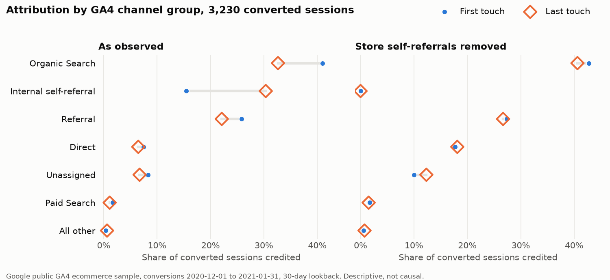

# Marketing Measurement Decision Studio

Where does an ecommerce store lose buyers, which channels get credit for the sales it
does make, and can session-start context pick out likely buyers for a limited review
queue? This project answers those questions on Google's public GA4 export for the
Google Merchandise Store, then serves the results through typed FastAPI contracts and
a Plotly Dash dashboard so every number on screen traces back to a query and a test.

## Key results

Public GA4 sample, 2020-11-01 through 2021-01-31. Funnel, retention and attribution
numbers come from
[`findings_summary.json`](data/derived/ga4_public_sample/findings_summary.json); model
numbers come from
[`conversion_model_evaluation.json`](data/derived/ga4_public_sample/conversion_model_evaluation.json).

| Question | Result | Context |
| --- | --- | --- |
| Where does the funnel narrow? | 5.96% of engaged sessions add to cart (14,919 of 250,206) | Other steps: view to engaged 74.98%, cart to checkout 39.92%, checkout to purchase 47.80%; 0.85% of 333,683 viewed sessions complete every stage |
| How complete is a same-session funnel? | It keeps 2,847 of at least 4,844 purchase sessions (58.77%) | 1,997 purchase sessions have no add-to-cart in the same session |
| Do new users come back? | 0.68% return on day 7 (1,611 of 238,644) | 85 first-touch cohorts with a fully observed day 7 |
| How much do self-referrals distort attribution? | 1,381 of 3,230 converted sessions (42.76%) include a store self-referral, which takes 980 last-touch credits | Organic Search first vs last touch: 1,324 vs 1,054 as observed, 1,380 vs 1,312 with self-referrals removed |
| Can session-start context rank buyers? | Held-out PR-AUC 0.0414 (95% CI 0.0274 to 0.0678) | No-skill 0.0139; returning-visitor rule 0.0240; gain over the rule 0.0174 (95% CI 0.0073 to 0.0402) |
| What does a 5% review queue yield? | Precision 6.94% (95% CI 4.13% to 9.94%), 4.98x the base rate | Flags 317 of 7,245 held-out sessions (4.38%) and finds 21.78% of the 101 held-out conversions |



As observed, last-touch gives the store's own domain 30% of the credit and the four
attribution rules disagree sharply. Treat those touches the way GA4's unwanted-referral
setting would and the rules largely converge: most of the first-versus-last
disagreement was a tracking artifact, not a difference in how channels behave.

## Approach

- **Session-scoped channels from event parameters.** Each session's channel is the
  first event-scoped `source / medium` pair, not `traffic_source` (which is the user's
  first acquisition). Channels are mapped to a simplified GA4 default channel grouping.
- **Strict funnel with a coverage check.** Stages are counted only when every earlier
  stage occurred in the same session, and stage-pattern aggregates measure how many
  purchases that rule drops.
- **True first-touch cohorts.** Retention cohorts use `user_first_touch_timestamp`
  and include only cohorts whose day 7 falls inside the data window.
- **Rule-based multi-touch attribution.** First touch, last touch, linear and
  position decay (each earlier touch gets half the weight) over a complete 30-day
  lookback, with credit conserved per conversion and a self-referral sensitivity
  analysis.
- **Leakage-safe propensity model.** Logistic regression and random forest on an
  exact allowlist of session-start features, a group-disjoint holdout, `GroupKFold`
  model selection inside the training split, and a capacity threshold frozen from
  out-of-fold training scores.
- **Baselines and uncertainty.** The model is compared with a no-skill baseline and a
  one-feature returning-visitor rule, with 95% intervals from a cluster bootstrap over
  user buckets.
- **Governed delivery.** Ten typed FastAPI v1 routes serve reviewed artifacts with
  SHA-256 provenance; the Dash dashboard reads only the API. A deterministic synthetic
  generator demonstrates audience-integration health, an intent-to-treat A/B analysis
  with a power gate, and a constrained budget allocation with sensitivity checks.

## Data

- **Source:** [Google Analytics 4 obfuscated sample ecommerce dataset](https://developers.google.com/analytics/bigquery/web-ecommerce-demo-dataset)
  (`bigquery-public-data.ga4_obfuscated_sample_ecommerce.events_*`), available
  through the BigQuery Public Datasets program under Google's terms. It is the GA4
  export for the Google Merchandise Store, with some values obfuscated (`<Other>`,
  `(data deleted)`).
- **Coverage:** 2020-11-01 through 2021-01-31. Units are sessions
  (`user_pseudo_id` + `ga_session_id`), first-touch user cohorts, and converted
  sessions for attribution.
- **What is committed:** compact aggregates from six bounded BigQuery queries in
  [`sql/bigquery/`](sql/bigquery/) and an identifier-free 36,211-session extract (a
  deterministic 10% user sample) for the model. No raw events or identifiers are
  committed. Retrieval metadata records each query's hash, bytes billed and a 4 GB
  billing cap; see [`docs/sources/ga4-public-sample.md`](docs/sources/ga4-public-sample.md).
- **Synthetic data:** the integration, experiment and budget views use a seeded
  generator (`seed=20260910`) that models consent eligibility, partner matching,
  delivery, exposure, cost and outcomes for 200 audience candidates. It is kept apart
  from the GA4 evidence and labeled as synthetic everywhere it appears.

## Repository structure

```text
sql/bigquery/          bounded source queries that produced the committed extracts
sql/staging, marts/    cross-engine SQL marts tested on a local fixture (DuckDB)
src/marketing_measurement/
  analysis/            funnel, cohorts, attribution, experiments, budget
  modeling/            leakage-safe conversion model, baselines, bootstrap
  quality/, ingestion/ data contracts and fixture validation
  simulation/          seeded synthetic integration generator
notebooks/             01 descriptive findings, 02 conversion model (executed)
data/observed/         committed public aggregates and model extract
data/derived/          evidence JSON written by the notebooks
api/                   FastAPI v1 contracts over reviewed artifacts
dashboard/             Plotly Dash interface that reads only the API
docs/                  model card, metric dictionary, lineage, API contracts
scripts/               retrieval, notebook gate, figure rendering
tests/                 SQL, analysis, model, API, dashboard and release tests
```

## Reproduce

Requires Python 3.12. Everything below runs offline from the committed extracts;
re-querying BigQuery needs your own billing project (see the source doc).

```bash
python3.12 -m venv .venv
.venv/bin/python -m pip install -r requirements.txt
.venv/bin/python -m pip install -e . --no-deps

make test            # SQL marts, analysis, model, API, dashboard and release tests
make notebooks       # re-execute both notebooks and rewrite data/derived/*.json
make figures         # redraw docs/figures/attribution_by_channel_group.png
make release-gate    # checksums, ruff, mypy, tests, offline notebook re-run vs reviewed outputs
```

Run the interfaces in two terminals with `make api` (http://127.0.0.1:8000/docs) and
`make dashboard` (http://127.0.0.1:8050). Screenshots of the reviewed dashboard:
[desktop](.impeccable/review/desktop.png), [mobile](.impeccable/review/mobile.png).

## Limitations

- **Old, obfuscated, single-store data.** The sample covers one merchandise store in
  late 2020, and obfuscated or unattributed values leave 12% of last-touch credit
  Unassigned even after self-referrals are removed. None of these rates transfer to
  another business.
- **Engagement is a proxy.** A session counts as engaged if it has a `user_engagement`
  event; GA4's `session_engaged` flag was not used, so the engagement rate is not
  GA4's reported metric.
- **Attribution is descriptive.** Rule-based credit ranks where to investigate; only
  randomized experiments establish incremental effect.
- **The model's acquisition features are mostly empty.** The extraction query reads
  source and medium from each session's first event, which usually carries neither,
  so 88.14% of sessions arrive as `(unattributed)`. Fixing that query and re-running
  the bounded retrieval is the clearest next improvement. With 101 held-out
  conversions the intervals are wide, and the holdout is random in time rather than
  forward-looking.
- **Synthetic views are demonstrations.** The 200-candidate experiment is deliberately
  underpowered (100 per arm against 4,209 planned per arm) and declares no winner.
